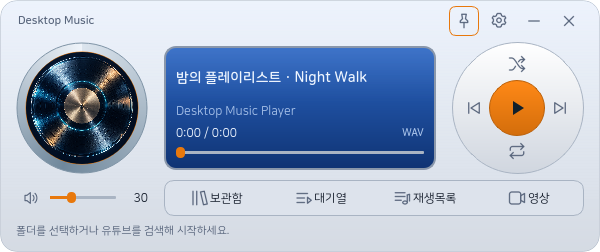
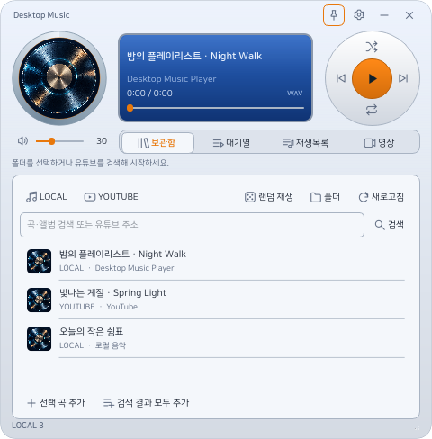
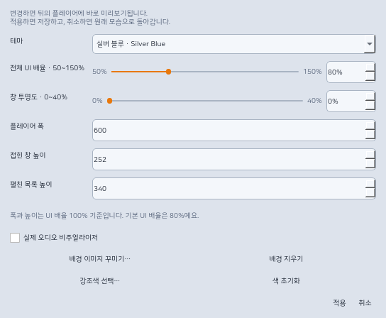
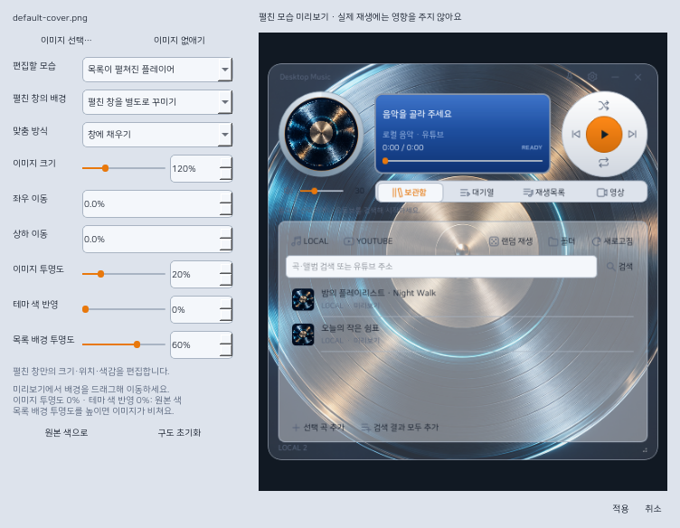

# Desktop Music Player

작은 MP3 플레이어를 닮은 Windows용 로컬·유튜브 음악 플레이어입니다. 보관함, 대기열, 재생목록, 영상은 플레이어 아래로 펼쳐집니다.

## 실행

배포본: `DesktopMusicPlayer-Windows.zip`을 풀고 **DesktopMusicPlayer.exe**를 실행하세요. 프로그램 폴더 전체를 함께 옮겨야 합니다.

소스 실행: Windows 10/11과 Python 3.10 이상에서 `setup.ps1`을 실행한 뒤 `start.cmd`를 실행하세요. 개발용 실행 창은 `python run.py`입니다.

## 음악 폴더와 배포

기본 로컬 음악 위치는 **프로그램 옆 music 폴더**입니다. 보관함의 **폴더** 버튼으로 기존 음악 폴더를 연결할 수 있습니다. 음악을 복사하지 않고 하위 폴더를 함께 검색합니다. MP3, FLAC, WAV, M4A, OGG, OPUS, AAC, WMA, AIFF를 지원합니다.

개인 경로는 `data/local.json` 또는 `data/player.sqlite3`에 저장합니다. 두 파일을 포함한 `data` 폴더는 Git과 배포 ZIP에서 제외됩니다. `config.example.json`은 상대 경로만 담습니다. 소스에 제작자의 음악 폴더가 하드코딩되어 있지 않습니다.

다른 PC에서는 폴더를 새로 선택하세요. 로컬 음악이 있는 위치가 달라지면 저장한 재생목록의 로컬 경로도 새로 등록해야 합니다.

## 사용

- **보관함 / LOCAL**: 검색으로 파일명·앨범 폴더를 찾고, 더블클릭으로 재생하거나 선택 곡을 대기열에 추가합니다.
- **보관함 / YOUTUBE**: 검색어, 영상 주소 또는 플레이리스트 주소를 넣고 검색합니다. 검색은 최대 10곡, 플레이리스트는 최대 300곡을 준비합니다.
- **주사위 버튼**: 로컬 보관함 또는 현재 로컬 검색 결과를 랜덤 순서로 재생합니다.
- **대기열**: 더블클릭으로 곡 이동, 선택 삭제, 비우기, 재생목록 저장을 제공합니다.
- **재생목록**: 로컬·유튜브가 섞인 목록을 저장·불러오기·삭제·JSON 가져오기/내보내기 할 수 있습니다. 내보낸 JSON에는 로컬 파일 위치가 포함됩니다.
- **영상**: 유튜브 재생 위치를 유지해 영상 스트림으로 전환합니다. 영상이 열린 동안만 별도 영상 스트림을 최대 720p로 동기화합니다. 영상 접근이 제한되면 오디오를 유지하고 원본 영상 버튼으로 브라우저에서 이어볼 수 있습니다.
- **설정**: 실버 블루, 미드나이트, 웜 크림, 비주얼라이저 테마와 배경 이미지·강조색·투명도·폭·높이·전체 UI 배율을 선택합니다. 기본 UI 배율은 **80%**, 범위는 **50~150%**이며 글꼴·아이콘·버튼·간격이 함께 바뀝니다. 배율은 50~150% 슬라이더와 숫자 입력으로 조절합니다. 테마·창 투명도·배율은 변경 즉시 뒤의 플레이어에 미리보기되며 적용하면 저장, 취소·Esc·닫기로 원래 모습으로 돌아갑니다. 설정창 자체는 배율 슬라이더를 움직이는 동안 고정됩니다. 배율 변경은 재생을 중단하지 않습니다. 가장자리와 네 모서리를 드래그해 창의 폭·높이를 조절할 수 있습니다.
- **핀 버튼**: 항상 위에 표시합니다. **× 버튼**은 트레이로 숨깁니다. 트레이 메뉴의 **종료**로 완전히 종료합니다.
- 셔플 버튼과 반복 버튼은 각각 무작위 재생, 반복 없음→전체→한 곡을 전환합니다.
- **배경 이미지**: 맞춤 방식·크기·좌우/상하 위치·이미지 투명도·테마 색 반영을 조절합니다. 미리보기에서 접힌/펼친 모습을 선택하고 배경을 드래그할 수 있습니다. 펼친 배경은 같은 설정, 윗부분 구도 유지, 별도 꾸미기 중 선택합니다. 별도 모드는 크기·위치·이미지 투명도·테마 색 반영을 따로 저장합니다. 목록 배경 투명도(0~90%)로 이미지가 비치는 정도를 정할 수 있습니다. 실제 재생과 목록 열림 상태는 미리보기 전환에 영향을 받지 않습니다. 취소하면 원래 설정으로 돌아가며 설정창 안에서 연 배경 편집도 최종 설정 적용 전에는 저장되지 않습니다. **원본 색으로** 버튼은 이미지 투명도와 테마 색 반영을 모두 0%로 맞춥니다.
- 단축키: `Space` 재생/일시정지, `S` 정지, `M` 음소거, `←/→` 5초 탐색, `Shift+←/→` 30초 탐색, `Ctrl+←/→` 이전/다음 곡, `Ctrl+↑/↓` 볼륨 ±5, `Ctrl+1~4` 보관함/대기열/재생목록/영상, `Ctrl+F` 검색, `Esc` 목록 닫기, `Ctrl+Q` 종료, `F1` 전체 단축키. 글을 입력할 때는 Space와 방향키를 가로채지 않습니다.
- 음악 파일을 창에 끌어다 놓아 대기열에 추가할 수 있습니다.

음악 폴더 목록을 캐시하며 시작 시 오래된 캐시만 백그라운드에서 갱신합니다. 유튜브 검색·스트림 추출은 별도 작업에서 처리합니다. 오디오 전용 상태에서는 영상 스트림을 사용하지 않습니다. 실제 오디오 비주얼라이저는 최대 20fps이며 숨김·최소화 상태에서는 멈춥니다. 음성을 녹음하거나 AI를 실행하지 않습니다.

## 개발과 검증

`python -m unittest discover -s tests`로 기본 동작을 검증합니다.

`python tools/smoke_ui.py`는 테마 화면 캡처와 오디오·비주얼라이저 검사를 실행합니다. `python tools/measure_performance.py`는 성능·실제 유튜브 연결 결과를 `artifacts`에 저장합니다.

먼저 `pip install -r requirements-dev.txt`로 개발 도구를 설치하세요.

`python tools/build.py`로 Windows 실행 파일과 개인 데이터를 제외한 배포 ZIP을 만듭니다. 빌드 도구는 `requirements-dev.txt`에 있습니다.

배경 편집은 최신 입력을 약 30fps로 반영하고, 같은 목록 스타일과 이미지 구도는 다시 계산하지 않습니다. 생성한 4K 이미지·12,926곡 가상 목록으로 측정했을 때 확대/이동 갱신 중앙값이 약 121ms에서 5ms로 줄었습니다. 측정 도구는 `python tools/measure_editing.py`이며 PC와 화면 크기에 따라 결과가 달라집니다. 마우스 클릭 후 아이콘의 포커스 테두리가 남지 않고 Tab 키로 이동할 때는 표시됩니다.

윗부분 이미지 구도 유지 모드는 펼치기·접기 애니메이션 동안 같은 구도를 사용합니다. 설정·배경 편집의 숫자 입력칸은 내부 여백을 중복 적용하지 않고, 최대값과 % 표시가 들어갈 폭을 확보합니다.

최종 검증 기록은 `docs/verification.json`에 있습니다. 39개 회귀 검사, 50~150% UI 배율과 Windows 125%·150% DPI, 실제 YouTube 두 곡의 영상 전환·탐색·일시정지 검사를 통과했습니다. 이번 8초 측정에서 오디오 메모리는 약 144MB, 백그라운드 재생 CPU는 평균 0.38%였습니다. CPU는 논리 코어 하나를 100%로 계산하며 PC·저장장치·백그라운드 작업에 따라 달라집니다. 12,926곡 전체 폴더 검사에는 이번 측정에서 9.16초가 걸렸고 시작 시 저장된 보관함 캐시를 우선 사용합니다.

## 디자인 협업

기능 구현은 GPT-6.1 Sol, 디자인·테마·글꼴 검토는 MCP로 연결한 Claude Opus 5.5를 사용했습니다. 로그인 도구와 개발 PC의 MCP 연결 파일은 배포와 Git에서 제외합니다. 네이버 **나눔스퀘어라운드 Regular/Bold**를 함께 배포하며 미지원 글자는 Windows 기본 글꼴로 표시합니다. 원본·라이선스는 `assets/fonts`, 출처와 해시는 `docs/font-provenance.json`에 있습니다.

주황·상아색 음표 아이콘은 기본 ImageGen 도구로 생성했습니다. `assets/app-icon.png`, Windows용 다중 크기 `assets/app.ico`, 생성 지시문 `docs/imagegen-app-icon-prompt.txt`를 포함합니다. 실행 파일·작업표시줄·트레이가 같은 아이콘을 사용합니다.

## 유튜브 연결

유튜브 접근 상태에 따라 일부 영상이나 계정·지역 제한 영상은 재생할 수 없습니다. 유효기간이 지난 스트림이나 연결 오류는 현재 위치를 보존해 한 번 새 주소로 다시 연결합니다. 영상 오류는 오디오에 영향을 주지 않습니다. 복구되지 않으면 상태 메시지를 확인하고 다시 재생하거나 원본 영상을 열어 주세요. 오류 유형은 `data/player.log`에 기록하며 서명된 스트림 주소를 지웁니다. 스트림 주소는 메모리에만 보관하며 재생목록에는 원본 유튜브 주소를 저장합니다.
