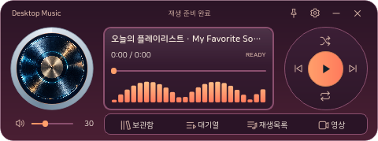
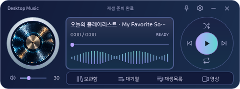

# Desktop Music Player

작은 MP3 플레이어를 닮은 Windows용 로컬·유튜브 음악 플레이어입니다. 보관함, 대기열, 재생목록, 영상은 플레이어 아래로 펼쳐집니다.

## 실행

배포본: `DesktopMusicPlayer-Windows.zip`을 풀고 **DesktopMusicPlayer.exe**를 실행하세요. 프로그램 폴더 전체를 함께 옮겨야 합니다.

소스 실행: Windows 10/11과 Python 3.10 이상에서 `setup.ps1`을 실행한 뒤 `start.cmd`를 실행하세요. 개발용 실행 창은 `python run.py`입니다.

## 음악 폴더와 배포

기본 로컬 음악 위치는 **프로그램 옆 music 폴더**입니다. 보관함의 **폴더** 버튼으로 기존 음악 폴더를 연결할 수 있습니다. 음악을 복사하지 않고 하위 폴더를 함께 검색합니다. MP3, FLAC, WAV, M4A, OGG, OPUS, AAC, WMA, AIFF와 MP4, MKV, WEBM, MOV, M4V, AVI, MPG, MPEG를 보관함에 등록합니다. 실제 재생 가능 여부는 파일의 코덱에 따라 달라집니다. 기존 보관함은 영상 지원 업데이트 후 한 번 자동 갱신합니다.

개인 경로는 `data/local.json` 또는 `data/player.sqlite3`에 저장합니다. 두 파일을 포함한 `data` 폴더는 Git과 배포 ZIP에서 제외됩니다. `config.example.json`은 상대 경로만 담습니다. 소스에 제작자의 음악 폴더가 하드코딩되어 있지 않습니다.

다른 PC에서는 폴더를 새로 선택하세요. 로컬 음악이 있는 위치가 달라지면 저장한 재생목록의 로컬 경로도 새로 등록해야 합니다.

## 사용

- **보관함 / LOCAL**: 검색으로 파일명·앨범 폴더를 찾고, 더블클릭으로 재생하거나 선택 곡을 대기열에 추가합니다.
- **보관함 / YOUTUBE**: 검색어, 영상 주소 또는 플레이리스트 주소를 넣고 검색합니다. 검색 결과는 한 페이지에 10곡이며 **이전 페이지 / 다음 페이지**로 계속 볼 수 있습니다. 첫 페이지부터 필요한 10곡과 다음 페이지 확인용 1곡만 읽습니다. 다음 결과는 페이지를 넘길 때 가져오고 이미 본 페이지는 메모리에서 복원합니다. **이 페이지 모두 추가**는 표시 중인 10곡만 추가합니다. 재생목록 주소는 재생 가능한 전체 곡을 원래 순서로 불러옵니다. **재생목록 전체 추가 (N곡)**로 모두 대기열에 등록합니다. LOCAL 탭에서도 유튜브 링크를 붙여 넣고 검색하면 YOUTUBE로 전환하며 공유 링크·꺾쇠·마크다운 링크·프로토콜 없는 유튜브 주소를 인식합니다.
- **주사위 버튼**: 로컬 보관함 또는 현재 로컬 검색 결과를 랜덤 순서로 재생합니다.
- **대기열**: 현재곡·다음곡·예약 번호를 표시합니다. 드래그로 순서를 바꾸면 현재 재생과 이전 곡 기록을 보존합니다. 수동 순서 지정 시 셔플을 끄고 지정 순서대로 재생하며, 셔플 중에는 다음 곡이 무작위이므로 대기 곡을 ‘셔플 대기’로 표시합니다. 이미 지난 곡은 ‘이전곡’으로 구분합니다. 더블클릭 재생, 선택 삭제, 비우기, 재생목록 저장도 지원합니다.
- **우클릭 메뉴**: 보관함·대기열에서 바로 재생, 선택 곡으로 새 재생목록 저장, 기존 재생목록에 추가, 원본 유튜브 또는 파일 위치 열기를 제공합니다. 보관함에서는 대기열 추가, 대기열에서는 선택 삭제도 지원합니다. Ctrl/Shift로 여러 곡을 선택한 뒤 우클릭할 수 있습니다.
- **표지**: 로컬 파일의 내장 앨범 표지를 우선 사용하고, 없으면 같은 폴더의 이미지(cover/folder/front/album 이름 우선)를 표시합니다. 둘 다 없거나 읽지 못하면 기존 디스크 이미지가 나옵니다. 유튜브는 영상 썸네일을 사용합니다. 목록 아이콘과 왼쪽 디스크에 모두 반영하며 필요할 때만 백그라운드에서 로딩합니다. 최대 96개·256px 이미지와 실패 결과를 메모리에 캐시합니다. 폴더 표지를 바꿨다면 보관함의 새로고침을 누르세요.
- **재생목록**: 로컬·유튜브가 섞인 목록을 저장·불러오기·삭제·JSON 가져오기/내보내기 할 수 있습니다. 내보낸 JSON에는 로컬 파일 위치가 포함됩니다.
- **영상**: 유튜브와 로컬 영상 파일을 같은 재생 위치에서 표시합니다. 로컬 영상도 접힌 상태에서는 오디오만 재생하고 영상 탭을 열 때만 무음 영상 출력을 켭니다. 일시정지 상태로 열어도 현재 위치의 화면이 표시되며 닫으면 영상 디코더를 해제합니다. 영상이 열린 동안만 별도 영상 스트림을 최대 720p로 동기화합니다. 영상 접근이 제한되면 오디오를 유지하고 원본 영상 버튼으로 브라우저에서 이어볼 수 있습니다.
- **설정**: 실버 블루, 미드나이트, 웜 크림, 민트 네온과 커스텀 테마를 선택합니다. 커스텀은 배경·패널·본문·보조 글자·강조·테두리·파형 7색을 색상 선택창이나 HEX(#RRGGBB)로 편집하며 기존 테마의 색을 복사해 시작할 수 있습니다. 파형 색은 강조색과 독립적이며 배경·패널·강조·파형 각각의 시작 색, 끝 색, 그라디언트 사용 여부와 가로·세로·대각선 방향을 지정합니다. 배경 이미지·창 투명도·폭·높이·전체 UI 배율도 조절합니다. 기본 UI 배율은 **80%**, 범위는 **50~150%**이며 글꼴·아이콘·버튼·간격이 함께 바뀝니다. 배율은 50~150% 슬라이더와 숫자 입력으로 조절합니다. 테마와 5종 파형은 설정창 내부의 플레이어 미리보기에서 확인합니다. 미리보기 파형은 예시이며 실제 플레이어는 재생 오디오를 분석합니다. 테마·창 투명도·배율은 변경 즉시 뒤의 플레이어에도 미리보기되며 적용하면 저장, 취소·Esc·닫기로 원래 모습으로 돌아갑니다. 설정창 자체는 배율 슬라이더를 움직이는 동안 고정됩니다. 배율 변경은 재생을 중단하지 않습니다. 가장자리와 네 모서리를 드래그해 창의 폭·높이를 조절할 수 있습니다. 상태 문구는 상단 중앙으로 옮기고 접힌 최소 높이를 252px에서 224px로 줄였습니다(100% 기준, 기본 80%에서는 202px→179px). 기존 최소 높이는 자동으로 조정하고 사용자가 늘린 높이는 유지합니다.
- **저장 테마**: 커스텀 영역에서 이름을 입력하고 **이름으로 저장 → 적용**을 누르면 여러 테마를 보관합니다. 상단 테마 목록에서 선택하며 이름 변경·삭제도 지원합니다. 선택한 저장 테마의 색·그라디언트·파형 편집은 적용할 때 함께 저장하고, 취소하면 원래 상태로 복원합니다. **내보내기**에서 현재 테마 1개 또는 저장한 테마 전체를 JSON으로 공유하고 **불러오기**로 추가합니다. 같은 이름은 `(2)`처럼 새 이름을 붙여 보존합니다. 파일에는 7색·그라디언트·비주얼라이저 사용 여부와 모양이 담깁니다.
- **추가 그라디언트 테마**: **노을빛 살구**는 자주·와인 배경과 살구·코랄 막대를, **라벤더 오로라**는 남색·청록 배경과 라벤더·청록 네온 파형을 사용합니다. 설정 상단 목록에서 바로 선택할 수 있습니다.
- **비주얼라이저**: 테마와 별도로 켜거나 끄며 **클래식 막대 / LED 계단 / 미러 막대 / 라인 스펙트럼 / 네온 파형**에서 선택합니다. 파형 영역을 40px(50% 배율에서도 20px)로 키우고 긴 창에서는 중앙의 620px 기준 폭 안에 그립니다. 로그 주파수 24밴드와 표시 전용 자동 감도로 저음 쏠림·조용한 곡의 낮은 파형을 보완합니다. 재생 음량은 바꾸지 않습니다. 파형을 켜면 제목은 한 줄로 표시하며 전체 제목은 마우스를 올리면 확인할 수 있습니다.
- **핀 버튼**: 항상 위에 표시합니다. **× 버튼**은 트레이로 숨깁니다. 트레이 메뉴의 **종료**로 완전히 종료합니다.
- 셔플 버튼과 반복 버튼은 각각 무작위 재생, 반복 없음→전체→한 곡을 전환합니다.
- **배경 이미지**: 맞춤 방식·크기·좌우/상하 위치·이미지 투명도·테마 색 반영을 조절합니다. 미리보기에서 접힌/펼친 모습을 선택하고 배경을 드래그할 수 있습니다. 펼친 배경은 같은 설정, 윗부분 구도 유지, 별도 꾸미기 중 선택합니다. 별도 모드는 크기·위치·이미지 투명도·테마 색 반영을 따로 저장합니다. 목록 배경 투명도(0~90%)로 이미지가 비치는 정도를 정할 수 있습니다. 실제 재생과 목록 열림 상태는 미리보기 전환에 영향을 받지 않습니다. 취소하면 원래 설정으로 돌아가며 설정창 안에서 연 배경 편집도 최종 설정 적용 전에는 저장되지 않습니다. **원본 색으로** 버튼은 이미지 투명도와 테마 색 반영을 모두 0%로 맞춥니다.
- 단축키: `Space` 재생/일시정지, `S` 정지, `M` 음소거, `←/→` 5초 탐색, `Shift+←/→` 30초 탐색, `Ctrl+←/→` 이전/다음 곡, `Ctrl+↑/↓` 볼륨 ±5, `Ctrl+1~4` 보관함/대기열/재생목록/영상, `Ctrl+F` 검색, `Esc` 목록 닫기, `Ctrl+Q` 종료, `F1` 전체 단축키. 글을 입력할 때는 Space와 방향키를 가로채지 않습니다.
- 음악 파일을 창에 끌어다 놓아 대기열에 추가할 수 있습니다.

음악 폴더 목록을 캐시하며 시작 시 오래된 캐시만 백그라운드에서 갱신합니다. 유튜브 검색·스트림 추출은 별도 작업에서 처리합니다. 오디오 전용 상태에서는 영상 스트림을 사용하지 않습니다. 실제 오디오 비주얼라이저는 최대 20fps이며 숨김·최소화 상태에서는 멈춥니다. 음성을 녹음하거나 AI를 실행하지 않습니다.

## 개발과 검증

`python -m unittest discover -s tests`로 기본 동작을 검증합니다.

`python tools/smoke_ui.py`는 테마 화면 캡처와 오디오·비주얼라이저 검사를 실행합니다. `python tools/measure_performance.py`는 성능·실제 유튜브 연결 결과를 `artifacts`에 저장합니다.

검색 지연 회귀 검사는 실제 yt-dlp 추출기를 사용해 요청하지 않은 결과를 읽지 않는지 확인합니다. `python tools/smoke_appearance.py`는 테마·파형 화면과 FFT·그리기 비용을 `artifacts/appearance-v021`에 저장합니다. 빌드한 EXE의 `--self-test --test-appearance`로 커스텀 7색·그라디언트·기본 5종·추가 저장 테마 2종·5종 파형·JSON 왕복·취소 복원을 검사합니다. 빌드한 EXE의 `--self-test --test-search`로 실제 유튜브 첫·다음·이전 페이지를 검사할 수 있습니다. `--self-test --test-playlist "공유 재생목록 URL"`로 자동 인식·전체 추가·원래 순서 보존을 검사합니다.

먼저 `pip install -r requirements-dev.txt`로 개발 도구를 설치하세요.

`python tools/build.py`로 Windows 실행 파일과 개인 데이터를 제외한 배포 ZIP을 만듭니다. 빌드 도구는 `requirements-dev.txt`에 있습니다.

배경 편집은 최신 입력을 약 30fps로 반영하고, 같은 목록 스타일과 이미지 구도는 다시 계산하지 않습니다. 생성한 4K 이미지·12,926곡 가상 목록으로 측정했을 때 확대/이동 갱신 중앙값이 약 121ms에서 5ms로 줄었습니다. 측정 도구는 `python tools/measure_editing.py`이며 PC와 화면 크기에 따라 결과가 달라집니다. 마우스 클릭 후 아이콘의 포커스 테두리가 남지 않고 Tab 키로 이동할 때는 표시됩니다.

윗부분 이미지 구도 유지 모드는 펼치기·접기 애니메이션 동안 같은 구도를 사용합니다. 설정·배경 편집의 숫자 입력칸은 내부 여백을 중복 적용하지 않고, 최대값과 % 표시가 들어갈 폭을 확보합니다.

최종 검증 기록은 `docs/verification.json`에 있습니다. 102개 회귀 검사, 50~150% UI 배율과 Windows 125%·150% DPI, 실제 YouTube 두 곡의 영상 전환·탐색·일시정지 검사를 통과했습니다. 이번 8초 측정에서 오디오 메모리는 약 144MB, 백그라운드 재생 CPU는 평균 0.38%였습니다. CPU는 논리 코어 하나를 100%로 계산하며 PC·저장장치·백그라운드 작업에 따라 달라집니다. 12,926곡 전체 폴더 검사에는 이번 측정에서 9.16초가 걸렸고 시작 시 저장된 보관함 캐시를 우선 사용합니다.

## 디자인 협업

기능 구현은 GPT-6.1 Sol, 디자인·테마·글꼴 검토는 MCP로 연결한 Claude Opus 5.5를 사용했습니다. 로그인 도구와 개발 PC의 MCP 연결 파일은 배포와 Git에서 제외합니다. 네이버 **나눔스퀘어라운드 Regular/Bold**를 함께 배포하며 미지원 글자는 Windows 기본 글꼴로 표시합니다. 원본·라이선스는 `assets/fonts`, 출처와 해시는 `docs/font-provenance.json`에 있습니다.

주황·상아색 음표 아이콘은 기본 ImageGen 도구로 생성했습니다. `assets/app-icon.png`, Windows용 다중 크기 `assets/app.ico`, 생성 지시문 `docs/imagegen-app-icon-prompt.txt`를 포함합니다. 실행 파일·작업표시줄·트레이가 같은 아이콘을 사용합니다.

## 유튜브 연결

유튜브 접근 상태에 따라 일부 영상이나 계정·지역 제한 영상은 재생할 수 없습니다. 일반 곡은 압축 오디오를 임시 캐시에 먼저 준비한 뒤 재생해 중간 네트워크 끊김의 영향을 줄입니다. 첫 재생은 준비 시간이 조금 걸릴 수 있습니다. 캐시는 data/audio-cache에 저장하며 재인코딩하지 않습니다. 한 파일48MiB·최대12곡·전체192MiB·24시간 기준으로 오래된 항목을 정리합니다. 30분을 넘거나 48MiB를 넘는 콘텐츠는 스트리밍합니다. 유효기간이 지난 스트림이나 연결 오류는 현재 위치를 보존해 1·3·6초 간격으로 최대3회 다시 연결합니다. 30초 이상 정상 재생하면 다음 장애를 위한 복구 횟수를 초기화합니다. 오류 없이15초 동안 재생이 멈춘 경우도 감지합니다. 수동 일시정지는 재연결을 일으키지 않으며 복구 중 일시정지·탐색도 유지합니다. 영상 오류는 오디오에 영향을 주지 않습니다. 복구에 실패하면 오디오·영상 디코더를 중단해 같은 오류가 계속 반복되지 않게 합니다. 재생 버튼을 누르면 보존한 위치에서 다시 시도합니다. 인터넷 연결이 계속 끊기거나 유튜브가 접근을 제한하는 경우에는 원본 영상으로 확인할 수 있습니다. 오류 유형은 `data/player.log`에 기록하며 서명된 스트림 주소를 지웁니다. 스트림 주소는 메모리에만 보관하며 재생목록에는 원본 유튜브 주소를 저장합니다.

현재 유튜브 재생은 미디어 스트림을 직접 여는 방식이며 별도 광고 삽입·감지·건너뛰기 처리를 구현하지 않습니다. 일반 웹 플레이어 광고가 표시되지 않는 경우가 많지만 광고 없는 재생을 보장하지 않습니다. 영상 자체에 포함된 광고·협찬은 그대로 재생합니다. 원본 영상 버튼으로 브라우저에서 열면 로그인 상태와 유튜브 광고 정책이 적용됩니다. [YouTube의 삽입 영상 광고 안내](https://support.google.com/youtube/answer/132596?hl=ko)
